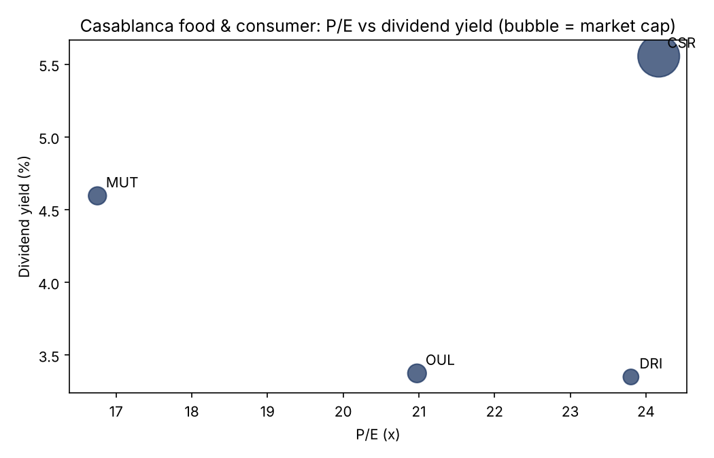

# Casablanca Valuation Screener

**Status:** version 0.1, working. Coverage grows company by company.

Which companies on the Casablanca Stock Exchange look cheap or expensive compared with their sector, and why?

## What it does
1. Reads one table of company inputs (`data/companies.csv`): price, shares, revenue, EBITDA, net income, net debt, book equity, dividend.
2. **Computes automatically:** market cap, P/E, EV/EBITDA, price to sales, price to book, dividend yield, payout ratio and net debt to EBITDA.
3. **Compares each company with its sector median** and shows its premium or discount.
4. **Treats banks and insurers separately:** no EV/EBITDA for them, only P/E, price to book and dividend yield.
5. **Never guesses:** if an input is missing, or earnings are negative, the ratio is left empty.
6. Includes a **standard DCF** (`src/dcf.py`), with the same logic as the Excel model in [mutandis-valuation](https://github.com/KamarIsTheMoon/mutandis-valuation), to be run company by company with its own assumptions.

## First results: food and consumer sector (FY2025 figures)

| Ticker | Company | Market cap (MAD m) | P/E | P/E vs sector | EV/EBITDA | Dividend yield | Payout |
|---|---|---|---|---|---|---|---|
| MUT | Mutandis | 2,114 | 16.8x | -25% | 9.3x | 4.6% | 77.0% |
| OUL | Oulmès | 2,356 | 21.0x | -6% | | 3.4% | 70.8% |
| DRI | Dari Couspate | 1,247 | 23.8x | +6% | | 3.3% | 79.7% |
| CSR | Cosumar | 17,008 | 24.2x | +8% | | 5.6% | 134.3% |



**First reading**
- **Mutandis trades at the lowest P/E of the group**, about 25% below the sector median, with a 4.6% dividend yield. Cheap, or cheap for a reason (falling revenue in 2025)? That is the question [mutandis-valuation](https://github.com/KamarIsTheMoon/mutandis-valuation) works on.
- **Cosumar's payout ratio is above 100%**: the dividend per share is higher than earnings per share on these figures. Either it paid out more than it earned in 2025, or the net income figure used is not the right one. To verify in Cosumar's own results before drawing any conclusion.
- EV/EBITDA is only available for Mutandis so far: EBITDA and net debt of the others still need to be collected.

> Prices are not all from the same day (see `price_date`), and most figures come from a secondary source. These results show how the tool works; they are not investment conclusions.

## Run it
```
pip install -r requirements.txt
python -m src.run          # writes output/screener.csv, screener.md and the chart
python -m pytest tests     # automated tests
```

To add a company: add one row to `data/companies.csv` and its source to `data/SOURCES.md`.

## Repository
```
data/     company inputs and sources
src/      multiples, sector comparison, DCF, runner
output/   screener table and chart
tests/    automated tests
```

## Roadmap
- [x] Multiples and sector comparison, with missing data handled safely
- [x] Banks and insurers handled separately
- [x] Standard DCF function, tested
- [x] First sector: food and consumer (4 companies)
- [ ] EBITDA and net debt for every company, from official results
- [ ] All prices on the same date
- [ ] Banks (Attijariwafa bank, CIH Bank, BCP, Bank of Africa) and other sectors
- [ ] Run the DCF for each company with its own assumptions
- [ ] Fill the inputs automatically with [annual-report-assistant](https://github.com/KamarIsTheMoon/annual-report-assistant)

*Student project for learning purposes. Not investment advice.*

© 2026 Kamar Maroihi. All rights reserved.
